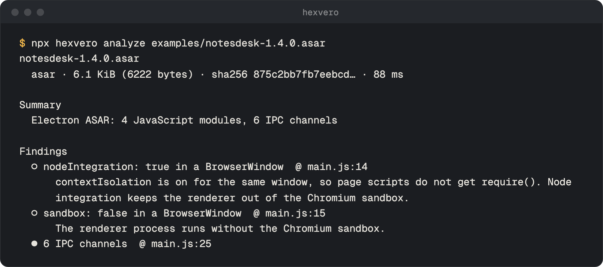
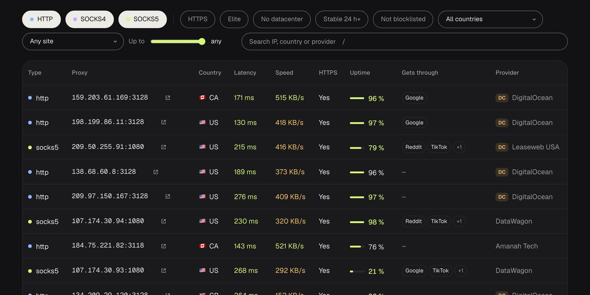
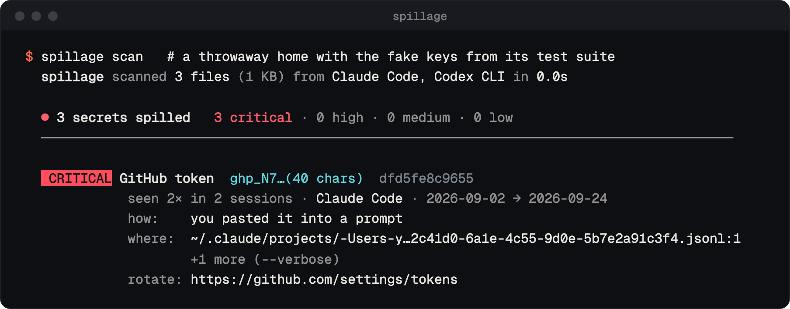
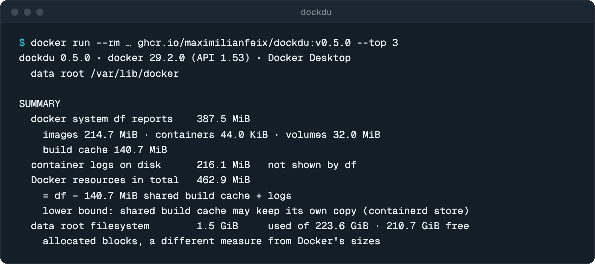

# Hey, I'm Maxi 👋

Apprentice at Hetzner by day; in my own time I build open-source developer tools for backend and infrastructure work. Each of them shows its evidence: what it checked, where an answer comes from, and what it couldn't find out.

[Projects](#projects) · [Portfolio](https://maximilianfeix.github.io) · [Say hello](https://github.com/maximilianfeix/proxy-scraper/discussions)

<a href="https://maximilianfeix.github.io/repoville/r/maximilianfeix/repoville/">
  <picture>
    <source media="(prefers-reduced-motion: reduce) and (prefers-color-scheme: dark)" srcset="./assets/city/city-night.jpg">
    <source media="(prefers-reduced-motion: reduce)" srcset="./assets/city/city-day.jpg">
    <source media="(prefers-color-scheme: dark)" srcset="./assets/city/city-night.webp">
    
  </picture>
</a>

**My code, as a city.** [repoville](https://github.com/maximilianfeix/repoville) rendered from its own repository at commit [`1557ddf`](https://github.com/maximilianfeix/repoville/commit/1557ddf5eb1f25352efa4875f63562629674b7dd) (16 Oct 2026, 137 files, 10,819 lines). Every file is a building as tall as its line count; fire on a roof means commits in the last year. Recorded in the [published demo](https://maximilianfeix.github.io/repoville/r/maximilianfeix/repoville/), which you can open and walk around in.

## Projects

### [hexvero](https://github.com/maximilianfeix/hexvero)

Tells you what a binary or app bundle contains and exposes, without running it, with the file and line behind every fact. [Example report →](https://maximilianfeix.github.io/hexvero/demo/)

<!--BADGES:hexvero:start-->
  
<!--BADGES:hexvero:end-->

### [proxy-scraper](https://github.com/maximilianfeix/proxy-scraper)

Free HTTP and SOCKS proxies from 700+ sources, kept only if they pass every check, as an hourly list, a rotating proxy and an MCP server. [Live list →](https://maximilianfeix.github.io/proxy-scraper/)

<!--BADGES:proxy-scraper:start-->
  
<!--BADGES:proxy-scraper:end-->

### [spillage](https://github.com/maximilianfeix/spillage)

Finds the API keys your coding agents wrote into their logs, scrubs them, and installs hooks that block the next leak. [Website →](https://maximilianfeix.github.io/spillage/)

<!--BADGES:spillage:start-->
  
<!--BADGES:spillage:end-->

### [dockdu](https://github.com/maximilianfeix/dockdu)

Shows where Docker's disk space went, including the container logs `docker system df` leaves out. Read-only, one command.

<!--BADGES:dockdu:start-->
  
<!--BADGES:dockdu:end-->

<b>More projects</b>

 

| Repository | What it is |
|---|---|
| [kuerzel](https://github.com/maximilianfeix/kuerzel) | A desktop studio for Espanso snippets: write, test and check text expansions without editing YAML |
| [RepoAtlas](https://github.com/maximilianfeix/repoatlas) | An interactive architecture map of a TypeScript repo; every connection links to the import that proves it |
| [gha-preview](https://github.com/maximilianfeix/gha-preview) | Explore a GitHub Actions workflow as a job graph in the browser before you push |
| [dejabuilt](https://github.com/maximilianfeix/dejabuilt) | An agent skill that checks GitHub before you build |
| [free-proxy-list](https://github.com/maximilianfeix/free-proxy-list) | The hourly list from proxy-scraper, per country, as JSON and CSV |
| [AxonPHPCLI](https://github.com/maximilianfeix/AxonPHPCLI) | PHP CLI that inspects a project and generates its CI pipeline |

## Tools I use

  &nbsp;
  &nbsp;
  &nbsp;
  &nbsp;
  &nbsp;
  &nbsp;
  &nbsp;
  &nbsp;
  

TypeScript and Node.js for hexvero and repoville (its viewer is Three.js), Python for proxy-scraper and spillage, Go for dockdu, PHP in older projects. Icons from [skill-icons](https://github.com/tandpfun/skill-icons) (MIT).

## Activity

<picture>
  <source media="(max-width: 600px) and (prefers-color-scheme: dark)" srcset="./assets/stats-dark-narrow.svg">
  <source media="(max-width: 600px)" srcset="./assets/stats-light-narrow.svg">
  <source media="(prefers-color-scheme: dark)" srcset="./assets/stats-dark.svg">
  
</picture>

<!--SNAKE:start-->
<picture>
  <source media="(prefers-reduced-motion: reduce) and (prefers-color-scheme: dark)" srcset="./assets/snake/contributions-static-dark.svg">
  <source media="(prefers-reduced-motion: reduce)" srcset="./assets/snake/contributions-static-light.svg">
  <source media="(prefers-color-scheme: dark)" srcset="./assets/snake/github-snake-dark.svg">
  
</picture>

My contribution graph as an animated snake, redrawn daily with [Platane/snk](https://github.com/Platane/snk). It's an animation, not a game you can play here.
<!--SNAKE:end-->

<!--NUMBERS:start-->
As of 19 Oct 2026 (downloads fetched 19 Oct 2026), updated regularly by this repository's workflows. Public repositories only. PRs count merged pull requests in repositories I don't own; 6 entries for my own projects in awesome lists are left out. Downloads are downloads, not users or unique installs.
<!--NUMBERS:end-->

<b>Download figures: definition, window, source, fetch date</b>

 

<!--DATA:start-->
| Figure | Value | Window | Definition | Source | Fetched |
|---|---|---|---|---|---|
| hexvero · npm downloads | 3,140 | 2026-09-19 – 2026-10-18 | Sum of the daily npm downloads of the CLI package in the 30-day window npm reports; the workspace packages it depends on are not added. | [api.npmjs.org/downloads/range/last-month/hexvero](https://www.npmjs.com/package/hexvero) | 19 Oct 2026 |
| proxy-scraper · PyPI downloads | 3,471 | 2026-09-19 – 2026-10-18 | Sum of the daily PyPI downloads without mirrors (pypistats.org, from PyPI's public BigQuery data) over the 30 days up to the last day with figures. The package's figures start on 2026-09-26. | [pypistats.org/api/packages/proxy-scraper-cli/overall?mirrors=false](https://pypistats.org/packages/proxy-scraper-cli) | 19 Oct 2026 |
| spillage · PyPI downloads | 492 | 2026-09-19 – 2026-10-18 | Sum of the daily PyPI downloads without mirrors (pypistats.org, from PyPI's public BigQuery data) over the 30 days up to the last day with figures. The package's figures start on 2026-10-10. | [pypistats.org/api/packages/spillage/overall?mirrors=false](https://pypistats.org/packages/spillage) | 19 Oct 2026 |
| dockdu · GitHub downloads | 45 | all time | Sum of download_count of the 32 program archives (one per OS and CPU) across all 8 releases; checksums and other files are not counted. Homebrew cask installs fetch these archives and are included; go install, container image pulls and git clones are not. | [GitHub API, releases and assets of maximilianfeix/dockdu (all pages)](https://github.com/maximilianfeix/dockdu/releases) | 19 Oct 2026 |
<!--DATA:end-->

A failed fetch keeps the last valid figure with its original date; it never shows up as zero. Each successful fetch is appended to [`data/downloads.csv`](data/downloads.csv). How the profile is built and maintained: [`docs/MAINTAINING.md`](docs/MAINTAINING.md).

## Contributions

- **[HKUDS/DeepTutor #1627](https://github.com/HKUDS/DeepTutor/pull/1627)**: a multi-line formula with `$$` right against it showed up as raw text; the fences are now moved onto their own lines, so it renders as math.
- **[semantica-agi/semantica #1827](https://github.com/semantica-agi/semantica/pull/1827)**: `HybridSearch.search(filter=…)` silently ignored the filter; `filter` now works as a deprecated alias of `metadata_filter`, and passing both raises an error.
- **[intuit/stunt-double #75](https://github.com/intuit/stunt-double/pull/75)**: a mock factory that raised was only logged and treated as "no mock"; it now surfaces as a `MockFactoryError` or an error result.

## Recently shipped

<!--SHIPPED:start-->
- **[hexvero v0.11.1](https://github.com/maximilianfeix/hexvero/releases/tag/v0.11.1)** · 18 Oct 2026
- **[proxy-scraper v1.30.0](https://github.com/maximilianfeix/proxy-scraper/releases/tag/v1.30.0)** · 16 Oct 2026
- **[repoville v0.14.3](https://github.com/maximilianfeix/repoville/releases/tag/v0.14.3)** · 16 Oct 2026
<!--SHIPPED:end-->

---

  <a href="https://maximilianfeix.github.io">Portfolio</a> ·
  <a href="https://github.com/maximilianfeix?tab=repositories&type=source">All repositories</a> ·
  <a href="https://github.com/maximilianfeix/proxy-scraper/discussions">Say hello</a>

