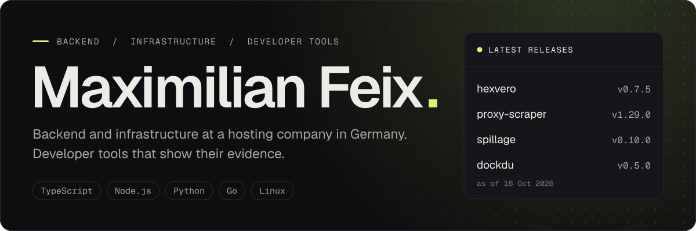
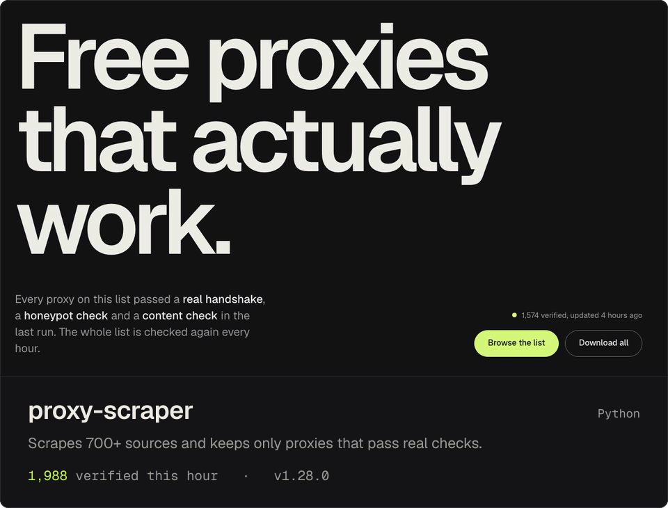
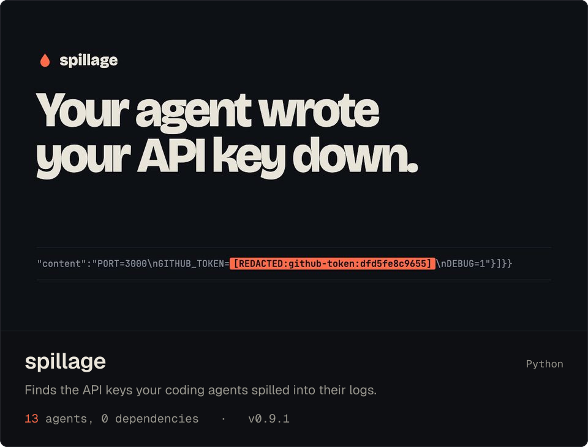
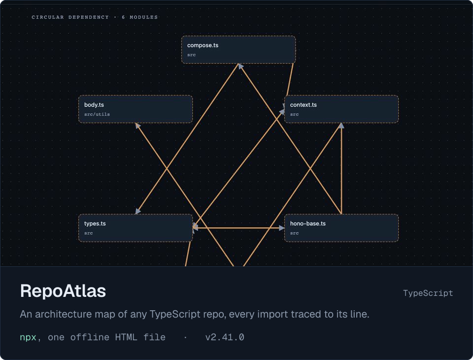
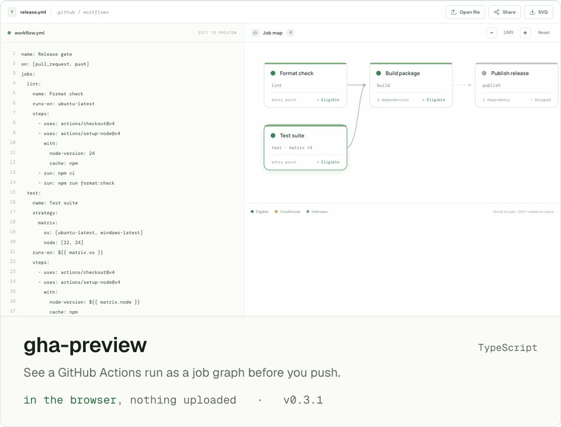
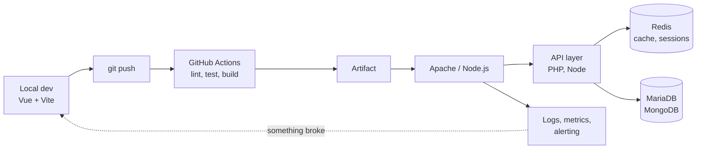
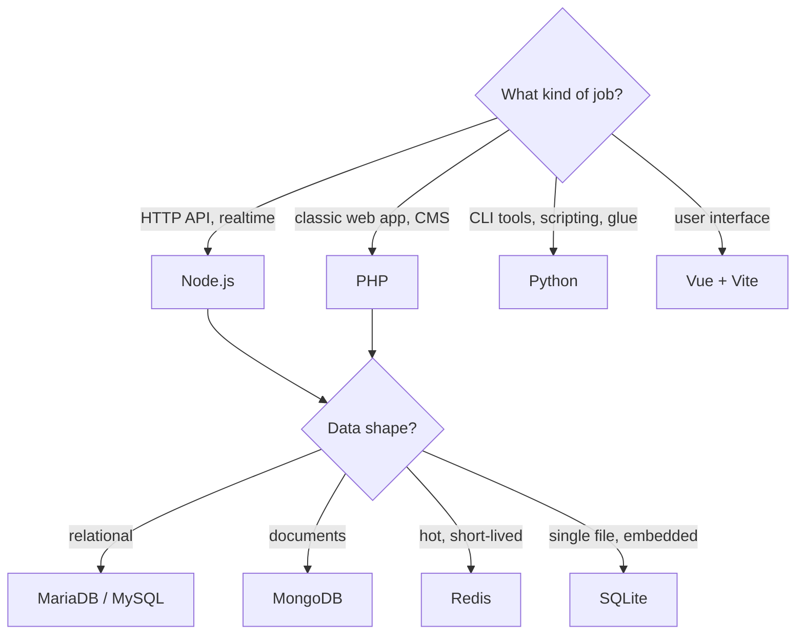
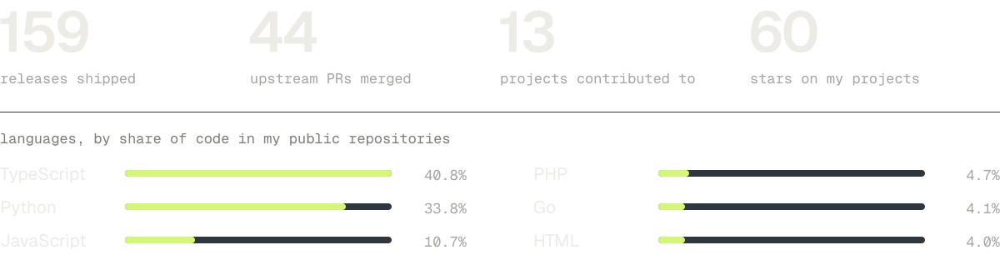

<p align="center">
  <picture>
    <source media="(prefers-color-scheme: dark)" srcset="./assets/header-dark.svg">
    <source media="(prefers-color-scheme: light)" srcset="./assets/header-light.svg">
    
  </picture>
</p>

<p align="center">
  <samp>
    <a href="#projects">projects</a> ·
    <a href="#open-source">open source</a> ·
    <a href="#how-i-work">how i work</a> ·
    <a href="#activity">activity</a>
  </samp>
</p>

Software developer from Germany, working at a hosting company. Most of my time goes into the parts users never see: APIs, deployment pipelines, database schemas and the automation that keeps all of it running without me. In my own time I build developer tools that do one job properly and show their work – tested, documented, released.

<table>
<tr>
<td width="50%" valign="top">

**What I do**

- Backend services in **Node.js**, **TypeScript**, **PHP** and **Python**, with **Vue** where a UI is needed
- The ops half of the job: **Linux**, **Apache**, **Redis**, **MariaDB**, cron and shell glue
- Automation that removes repetitive work – CI pipelines, scripts, bots
- Design when a project needs it: **Figma**, Photoshop, After Effects, Blender

</td>
<td width="50%" valign="top">

**Right now**

- Shipping **[spillage](https://github.com/maximilianfeix/spillage)** – secret scanning for coding-agent logs
- Just released **[dejabuilt](https://github.com/maximilianfeix/dejabuilt)** – an agent skill that checks GitHub before you build
- Maintaining **[proxy-scraper](https://github.com/maximilianfeix/proxy-scraper)** and **[RepoAtlas](https://github.com/maximilianfeix/repoatlas)**
- Building **devprofile.dev**
- Learning **microservices** – service boundaries, messaging, observability

</td>
</tr>
</table>

<a id="projects"></a>

## Projects

<p align="center">
  <a href="#proxy-scraper"></a>
  <a href="#spillage"></a>
</p>
<p align="center">
  <a href="#repoatlas"></a>
  <a href="#gha-preview"></a>
</p>

<p align="center"><sub>Real screenshots, live numbers – rebuilt every 3 hours by this repository's workflow.</sub></p>

<a id="proxy-scraper"></a>

### [proxy-scraper](https://github.com/maximilianfeix/proxy-scraper) &nbsp;<sub>Python</sub>

**Free proxies that actually work.** Scrapes HTTP/SOCKS4/SOCKS5 proxies from 700+ sources and verifies every hit: honeypots, injected scripts (one in five does it), verified TLS, anonymity and spam blocklists. Ships with a rotating proxy server, an MCP server for AI agents and a live dashboard.

**→ [Browse the live list](https://maximilianfeix.github.io/proxy-scraper/)**, re-checked every hour by GitHub Actions.

<a href="https://github.com/maximilianfeix/proxy-scraper/actions/workflows/tests.yml"></a> <a href="https://github.com/maximilianfeix/proxy-scraper/releases/latest"></a> <a href="https://github.com/maximilianfeix/proxy-scraper/tree/proxy-list"></a> <a href="https://github.com/maximilianfeix/proxy-scraper/stargazers"></a>

<a id="spillage"></a>

### [spillage](https://github.com/maximilianfeix/spillage) &nbsp;<sub>Python</sub>

**Find the API keys your coding agents spilled into their logs.** Claude Code, Codex, Gemini CLI, Cursor and the rest keep every conversation on disk as plain text. spillage reads the logs of thirteen agents, shows which keys leaked and how, scrubs them without breaking `--resume`, and installs hooks that block the next leak. 56 rules, no dependencies, no network access.

```sh
brew install maximilianfeix/tap/spillage && spillage
```

<a href="https://github.com/maximilianfeix/spillage/releases/latest"></a>  <a href="https://maximilianfeix.github.io/spillage/"></a>

<a id="repoatlas"></a>

### [RepoAtlas](https://github.com/maximilianfeix/repoatlas) &nbsp;<sub>TypeScript</sub>

**Understand any TypeScript repo in one interactive map.** Parses every import with the TypeScript compiler API and turns a project into a standalone architecture map – every connection links to the import statement and line that proves it.

```sh
npx --yes --package=github:maximilianfeix/repoatlas -- repoatlas https://github.com/pmndrs/zustand -o zustand-map.html
```

Try it on real projects: [**Zustand**](https://maximilianfeix.github.io/repoatlas/examples/zustand.html) <sub>18 modules</sub> · [**Ky**](https://maximilianfeix.github.io/repoatlas/examples/ky.html) <sub>51 modules</sub> · [**Hono**](https://maximilianfeix.github.io/repoatlas/examples/hono.html) <sub>247 modules, 676 connections</sub>

<a href="https://github.com/maximilianfeix/repoatlas/actions/workflows/ci.yml"></a> <a href="https://github.com/maximilianfeix/repoatlas/actions/workflows/codeql.yml"></a> <a href="https://github.com/maximilianfeix/repoatlas/releases/latest"></a>

<a id="gha-preview"></a>

### [gha-preview](https://github.com/maximilianfeix/gha-preview) &nbsp;<sub>TypeScript</sub>

**See the run before the run.** Paste a GitHub Actions workflow and explore it as a job graph: which jobs a `push` or `pull_request` would start and what a matrix expands to. Parsed in the browser; no account, no upload.

**→ [Try it in the browser](https://maximilianfeix.github.io/gha-preview/)**

<a href="https://github.com/maximilianfeix/gha-preview/actions/workflows/ci.yml"></a> <a href="https://github.com/maximilianfeix/gha-preview/releases/latest"></a> <a href="https://maximilianfeix.github.io/gha-preview/"></a>

<details>
<summary><b>Smaller things</b></summary>

<br>

| Repository | What it is |
|---|---|
| [free-proxy-list](https://github.com/maximilianfeix/free-proxy-list) | The hourly proxy list from proxy-scraper, per country, as JSON and CSV |
| [homebrew-tap](https://github.com/maximilianfeix/homebrew-tap) | Homebrew formulae – `brew install maximilianfeix/tap/spillage` |
| [AxonPHPCLI](https://github.com/maximilianfeix/AxonPHPCLI) | Tiny PHP CLI that generates GitHub Actions CI/CD configuration for PHP projects |
| [Mini-Laravel](https://github.com/maximilianfeix/Mini-Laravel) | Laravel-style PHP framework from scratch: router, DI container, controllers, middleware |
| [CurrentlyFreeDomains](https://github.com/maximilianfeix/CurrentlyFreeDomains) | Currently free `.de` domains |
| [C++ template for macOS](https://github.com/maximilianfeix/C--Template-fr-Mac) · [vocational school C++](https://github.com/maximilianfeix/Berufsschule-Anwendungsentwicklung-C-) | Starter template with VS Code tasks, and exercises from my apprenticeship |

</details>

<a id="open-source"></a>

## Open source

<table>
<tr>
<td width="55%" valign="top">

**Recently shipped**

<!--SHIPPED:start-->
- Merged [Progress: v0.10.0](https://github.com/maximilianfeix/repoville/pull/91) in **repoville** <sub>· 16 Oct 2026</sub>
- Released **[repoville v0.10.0](https://github.com/maximilianfeix/repoville/releases/tag/v0.10.0)** <sub>· 16 Oct 2026</sub>
- Merged [Delete docs/growth directory](https://github.com/maximilianfeix/dockdu/pull/50) in **dockdu** <sub>· 16 Oct 2026</sub>
- Released **[hexvero v0.7.5](https://github.com/maximilianfeix/hexvero/releases/tag/v0.7.5)** <sub>· 15 Oct 2026</sub>
- Released **[hexvero v0.7.4](https://github.com/maximilianfeix/hexvero/releases/tag/v0.7.4)** <sub>· 15 Oct 2026</sub>
- Released **[dockdu v0.5.0](https://github.com/maximilianfeix/dockdu/releases/tag/v0.5.0)** <sub>· 15 Oct 2026</sub>
<!--SHIPPED:end-->

</td>
<td width="45%" valign="top">

**Contributions to other projects**

<!--CONTRIB:start-->
- **[HKUDS/DeepTutor](https://github.com/HKUDS/DeepTutor)** <sub>★ 41.5k</sub><br><sub>[2 merged PRs](https://github.com/HKUDS/DeepTutor/pulls?q=is%3Apr+is%3Amerged+author%3Amaximilianfeix)</sub>
- **[semantica-agi/semantica](https://github.com/semantica-agi/semantica)** <sub>★ 14.1k</sub><br><sub>[6 merged PRs](https://github.com/semantica-agi/semantica/pulls?q=is%3Apr+is%3Amerged+author%3Amaximilianfeix)</sub>
- **[MakazhanAlpamys/Soup](https://github.com/MakazhanAlpamys/Soup)** <sub>★ 9.1k</sub><br><sub>[6 merged PRs](https://github.com/MakazhanAlpamys/Soup/pulls?q=is%3Apr+is%3Amerged+author%3Amaximilianfeix)</sub>
- **[mthcht/awesome-lists](https://github.com/mthcht/awesome-lists)** <sub>★ 1.9k</sub><br><sub>[1 merged PR](https://github.com/mthcht/awesome-lists/pulls?q=is%3Apr+is%3Amerged+author%3Amaximilianfeix)</sub>
- **[TensorBlock/awesome-mcp-servers](https://github.com/TensorBlock/awesome-mcp-servers)** <sub>★ 909</sub><br><sub>[2 merged PRs](https://github.com/TensorBlock/awesome-mcp-servers/pulls?q=is%3Apr+is%3Amerged+author%3Amaximilianfeix)</sub>
- **[conda-forge/staged-recipes](https://github.com/conda-forge/staged-recipes)** <sub>★ 848</sub><br><sub>[1 merged PR](https://github.com/conda-forge/staged-recipes/pulls?q=is%3Apr+is%3Amerged+author%3Amaximilianfeix)</sub>
<!--CONTRIB:end-->

</td>
</tr>
</table>

<a id="how-i-work"></a>

## How I work

| Principle | In practice |
|---|---|
| **Tested** | Tests that run offline and in CI – [proxy-scraper](https://github.com/maximilianfeix/proxy-scraper/actions/workflows/tests.yml) runs almost 500 of them on Linux, macOS and Windows, against fake proxies and honeypots on `localhost` |
| **Reviewed** | Changes start as an issue and land through a reviewed pull request – see the [proxy-scraper history](https://github.com/maximilianfeix/proxy-scraper/pulls?q=is%3Apr+is%3Amerged) |
| **Automated** | Lint, CodeQL, Dependabot, tagged releases and scheduled jobs on GitHub Actions – this profile updates itself too |
| **Minimal** | As few dependencies as the job allows – spillage has none, because it's a tool you point at your secrets |
| **Documented** | READMEs with a quick start, a changelog, contributing and security guides |

<details>
<summary><b>From commit to production – and which tool for which job</b></summary>

<br>



**What I reach for, and when**



</details>

<a id="activity"></a>

## Activity

<p align="center">
  <picture>
    <source media="(prefers-color-scheme: dark)" srcset="./assets/activity-dark.svg">
    <source media="(prefers-color-scheme: light)" srcset="./assets/activity-light.svg">
    
  </picture>
</p>

<p align="center"><sub>Public repositories only – counted by the same workflow that draws the banner.</sub></p>

<details>
<summary><b>How this profile updates itself</b></summary>

<br>

| Workflow | Status | What it does | When |
|---|---|---|---|
| [Profile](https://github.com/maximilianfeix/maximilianfeix/actions/workflows/profile.yml) | [](https://github.com/maximilianfeix/maximilianfeix/actions/workflows/profile.yml) | renders the banner, the project cards and the activity panel with live data (text set with HarfBuzz, so it looks the same everywhere), plus *Recently shipped* and *Contributions* ([script](scripts/build_profile.py)) | every 3 hours |
| [Link check](https://github.com/maximilianfeix/maximilianfeix/actions/workflows/links.yml) | [](https://github.com/maximilianfeix/maximilianfeix/actions/workflows/links.yml) | makes sure every link in this README still works | weekly |
| Dependabot | | keeps the pinned actions and the Python packages of the build script current | weekly |

</details>

---

<p align="center">
  <samp>
    <a href="https://maximilianfeix.github.io">portfolio</a> ·
    <a href="https://github.com/maximilianfeix?tab=repositories&type=source">all repositories</a> ·
    <a href="https://github.com/maximilianfeix/proxy-scraper/discussions">say hello</a>
  </samp>
</p>

<p align="center">
  <sub>Open to interesting backend and infrastructure work – the easiest way to reach me is an issue or discussion on one of my repositories.</sub>
</p>
