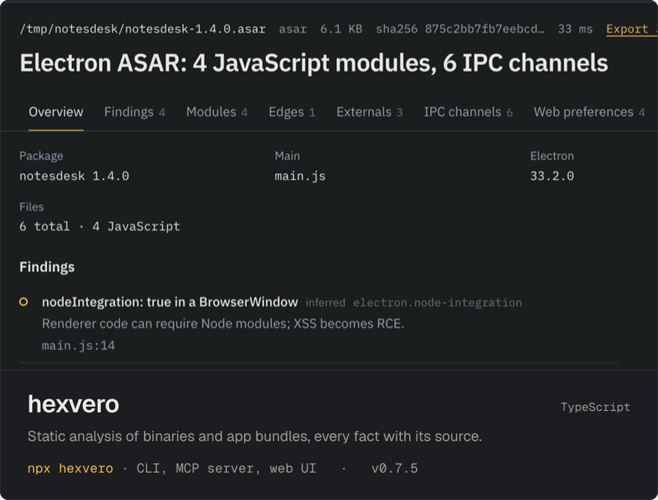
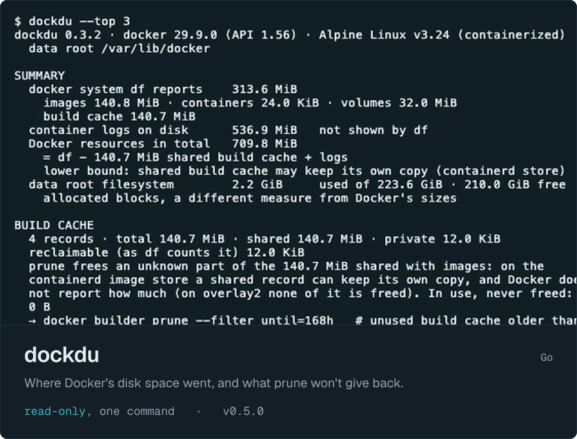

<p align="center">
  <picture>
    <source media="(prefers-color-scheme: dark)" srcset="./assets/header-dark.svg">
    <source media="(prefers-color-scheme: light)" srcset="./assets/header-light.svg">
    
  </picture>
</p>

<p align="center">
  <samp>
    <a href="#projects">projects</a> ·
    <a href="#contributions">contributions</a> ·
    <a href="#releases">releases</a> ·
    <a href="#about-the-numbers">about the numbers</a>
  </samp>
</p>

Software developer in Germany, working on backend and infrastructure at a hosting company: APIs, deployment pipelines, database schemas and the automation that keeps them running. In my own time I build small developer tools that say what they checked, where each answer comes from, and what they could not find out. Every one of them is tested in CI, released with a changelog and documented.

<p align="center">
  <picture>
    <source media="(prefers-color-scheme: dark)" srcset="./assets/activity-dark.svg">
    <source media="(prefers-color-scheme: light)" srcset="./assets/activity-light.svg">
    
  </picture>
</p>

<p align="center"><sub>Public repositories only · <a href="#about-the-numbers">how these are counted</a></sub></p>

<a id="projects"></a>

## Projects

<p align="center">
  <a href="#hexvero"></a>
  <a href="#proxy-scraper"></a>
</p>
<p align="center">
  <a href="#spillage"></a>
  <a href="#dockdu"></a>
</p>

<a id="hexvero"></a>

### [hexvero](https://github.com/maximilianfeix/hexvero) &nbsp;<sub>TypeScript</sub>

**A first look at a binary or app bundle, without running it.** Reads executables, Electron apps, APKs, archives and network captures and reports what they contain and expose: IPC channels, endpoints, storage, window settings. Each fact comes with the file and line it was read from and how sure it is. CLI, MCP server for coding agents and a local web UI; nothing leaves the machine.

```sh
npx hexvero analyze ./MyApp.app/Contents/Resources/app.asar
```

<!--BADGES:hexvero:start-->
<p><a href="https://www.npmjs.com/package/hexvero"></a> <a href="https://github.com/maximilianfeix/hexvero/actions/workflows/ci.yml"></a></p>
<!--BADGES:hexvero:end-->

<a id="proxy-scraper"></a>

### [proxy-scraper](https://github.com/maximilianfeix/proxy-scraper) &nbsp;<sub>Python</sub>

**Free proxies that actually work.** Collects public HTTP, SOCKS4 and SOCKS5 proxies from 700+ sources and keeps only the ones that pass every check, including a second request and verified TLS. Publishes a [checked list every hour](https://maximilianfeix.github.io/proxy-scraper/), turns the result into a rotating proxy, and ships an MCP server for AI agents.

```sh
pipx install proxy-scraper-cli
```

<!--BADGES:proxy-scraper:start-->
<p><a href="https://pypi.org/project/proxy-scraper-cli/"></a> <a href="https://pypistats.org/packages/proxy-scraper-cli"></a> <a href="https://github.com/maximilianfeix/proxy-scraper/actions/workflows/tests.yml"></a></p>
<!--BADGES:proxy-scraper:end-->

<a id="spillage"></a>

### [spillage](https://github.com/maximilianfeix/spillage) &nbsp;<sub>Python</sub>

**Keep API keys out of your coding agents.** Installs hooks in Claude Code, Codex CLI and Gemini CLI that block a prompt containing a key and stop the agent from reading `.env`. For what already got through, it scans the logs of fourteen agents, shows how each key got there and scrubs it without breaking `--resume`. No dependencies, no network access.

```sh
pipx install spillage
```

<!--BADGES:spillage:start-->
<p><a href="https://pypi.org/project/spillage/"></a> <a href="https://pypistats.org/packages/spillage"></a> <a href="https://github.com/maximilianfeix/spillage/actions/workflows/tests.yml"></a></p>
<!--BADGES:spillage:end-->

<a id="dockdu"></a>

### [dockdu](https://github.com/maximilianfeix/dockdu) &nbsp;<sub>Go</sub>

**Where did your Docker disk space go?** Shows what `docker system df` misses (container log files, build cache shared with images, storage per compose project) and what prune would not give back. Read-only: it never deletes anything, every suggestion is a command for you to run.

```sh
brew install maximilianfeix/tap/dockdu
```

<!--BADGES:dockdu:start-->
<p><a href="https://github.com/maximilianfeix/dockdu/releases/tag/v0.5.0"></a> <a href="https://github.com/maximilianfeix/dockdu/releases"></a> <a href="https://github.com/maximilianfeix/dockdu/actions/workflows/ci.yml"></a></p>
<!--BADGES:dockdu:end-->

<details>
<summary><b>More projects</b></summary>

<br>

| Repository | What it is |
|---|---|
| [RepoAtlas](https://github.com/maximilianfeix/repoatlas) | An interactive architecture map of a TypeScript repo; every connection links to the import that proves it |
| [gha-preview](https://github.com/maximilianfeix/gha-preview) | Explore a GitHub Actions workflow as a job graph in the browser before you push |
| [repoville](https://github.com/maximilianfeix/repoville) | A repository as a city: folders become districts, files buildings, in one HTML file |
| [kuerzel](https://github.com/maximilianfeix/kuerzel) | A desktop studio for Espanso snippets: write, test and check text expansions without editing YAML |
| [dejabuilt](https://github.com/maximilianfeix/dejabuilt) | An agent skill that checks GitHub before you build |
| [free-proxy-list](https://github.com/maximilianfeix/free-proxy-list) | The hourly list from proxy-scraper, per country, as JSON and CSV |
| [homebrew-tap](https://github.com/maximilianfeix/homebrew-tap) | Homebrew formulae and casks: `brew install maximilianfeix/tap/<tool>` |
| [AxonPHPCLI](https://github.com/maximilianfeix/AxonPHPCLI) | PHP CLI that inspects a project and generates its CI pipeline |
| [Mini-Laravel](https://github.com/maximilianfeix/Mini-Laravel) | Laravel-style PHP framework from scratch: router, DI container, controllers, middleware |

</details>

<a id="contributions"></a>

## Contributions

Selected fixes merged in other people's projects:

- **[HKUDS/DeepTutor](https://github.com/HKUDS/DeepTutor)**: display math whose `$$` wrap a multi-line formula rendered as plain text, now it renders ([#1627](https://github.com/HKUDS/DeepTutor/pull/1627))
- **[semantica-agi/semantica](https://github.com/semantica-agi/semantica)**: `HybridSearch` silently dropped the `filter=` argument; it is now passed to the vector store ([#1827](https://github.com/semantica-agi/semantica/pull/1827))
- **[MakazhanAlpamys/Soup](https://github.com/MakazhanAlpamys/Soup)**: PPO training hands trl only the token columns and refuses a train set smaller than one rollout batch ([#1410](https://github.com/MakazhanAlpamys/Soup/pull/1410))
- **[intuit/stunt-double](https://github.com/intuit/stunt-double)**: errors raised inside a mock factory were swallowed; they now reach the test ([#75](https://github.com/intuit/stunt-double/pull/75))
- **[IlyaP358/fluxcast](https://github.com/IlyaP358/fluxcast)**: `doctor` now finds `iw` and `wpa_cli` in `/usr/sbin` ([#164](https://github.com/IlyaP358/fluxcast/pull/164))
- **[conda-forge/staged-recipes](https://github.com/conda-forge/staged-recipes)**: recipe that packages proxy-scraper for conda-forge ([#35075](https://github.com/conda-forge/staged-recipes/pull/35075))

<sub>[All my merged pull requests](https://github.com/search?q=is%3Apr+is%3Amerged+author%3Amaximilianfeix+-user%3Amaximilianfeix&type=pullrequests)</sub>

<a id="releases"></a>

## Recent releases

<!--SHIPPED:start-->
- **[repoville v0.14.3](https://github.com/maximilianfeix/repoville/releases/tag/v0.14.3)** <sub>· 16 Oct 2026</sub>
- **[hexvero v0.7.5](https://github.com/maximilianfeix/hexvero/releases/tag/v0.7.5)** <sub>· 15 Oct 2026</sub>
- **[dockdu v0.5.0](https://github.com/maximilianfeix/dockdu/releases/tag/v0.5.0)** <sub>· 15 Oct 2026</sub>
- **[proxy-scraper v1.29.0](https://github.com/maximilianfeix/proxy-scraper/releases/tag/v1.29.0)** <sub>· 14 Oct 2026</sub>
- **[kuerzel v0.2.0](https://github.com/maximilianfeix/kuerzel/releases/tag/v0.2.0)** <sub>· 11 Oct 2026</sub>
<!--SHIPPED:end-->

<a id="about-the-numbers"></a>

## About the numbers

<!--NUMBERS:start-->
<sub>Figures as of 16 Oct 2026 (downloads fetched 16 Oct 2026), updated regularly by this repository's workflow. Upstream counts leave out my own accounts and 6 entries for my projects in awesome lists. Downloads are downloads, not users or unique installs.</sub>
<!--NUMBERS:end-->

<details>
<summary><b>Download figures: definition, window, source, fetch date</b></summary>

<br>

<!--DATA:start-->
| Figure | Value | Window | Definition | Source | Fetched |
|---|---|---|---|---|---|
| proxy-scraper · PyPI downloads | 3,268 | 2026-09-16 – 2026-10-15 | Sum of the daily PyPI downloads without mirrors (pypistats.org, from PyPI's public BigQuery data) over the 30 days up to the last day with figures. The package's figures start on 2026-09-26. | [pypistats.org/api/packages/proxy-scraper-cli/overall?mirrors=false](https://pypistats.org/packages/proxy-scraper-cli) | 16 Oct 2026 |
| spillage · PyPI downloads | 478 | 2026-09-16 – 2026-10-15 | Sum of the daily PyPI downloads without mirrors (pypistats.org, from PyPI's public BigQuery data) over the 30 days up to the last day with figures. The package's figures start on 2026-10-10. | [pypistats.org/api/packages/spillage/overall?mirrors=false](https://pypistats.org/packages/spillage) | 16 Oct 2026 |
| dockdu · GitHub downloads | 45 | all time | Sum of download_count of the 32 program archives (one per OS and CPU) across all 8 releases; checksums and other files are not counted. Homebrew cask installs fetch these archives and are included; go install, container image pulls and git clones are not. | [GitHub API, releases and assets of maximilianfeix/dockdu (all pages)](https://github.com/maximilianfeix/dockdu/releases) | 16 Oct 2026 |

No figure shown for **hexvero**: no data: npm has no download figures for this package yet.
<!--DATA:end-->

A failed fetch keeps the last valid figure with its original date; it never shows up as zero. Each successful fetch is also appended to [`data/downloads.csv`](data/downloads.csv), so growth can be shown from those dated snapshots later. Badges for version and downloads are built from [`data/metrics.json`](data/metrics.json) by the [profile workflow](https://github.com/maximilianfeix/maximilianfeix/actions/workflows/profile.yml) ([script](scripts/build_profile.py)), which runs every few hours and asks npm, PyPI and GitHub for downloads at most once a day. CI badges show the live status of each project's main branch.

</details>

---

<p align="center">
  <samp>
    <a href="https://maximilianfeix.github.io">portfolio</a> ·
    <a href="https://github.com/maximilianfeix?tab=repositories&type=source">all repositories</a> ·
    <a href="https://github.com/maximilianfeix/proxy-scraper/discussions">say hello</a>
  </samp>
</p>

<p align="center">
  <sub>Open to interesting backend and infrastructure work. The easiest way to reach me is an issue or discussion on one of my repositories.</sub>
</p>
